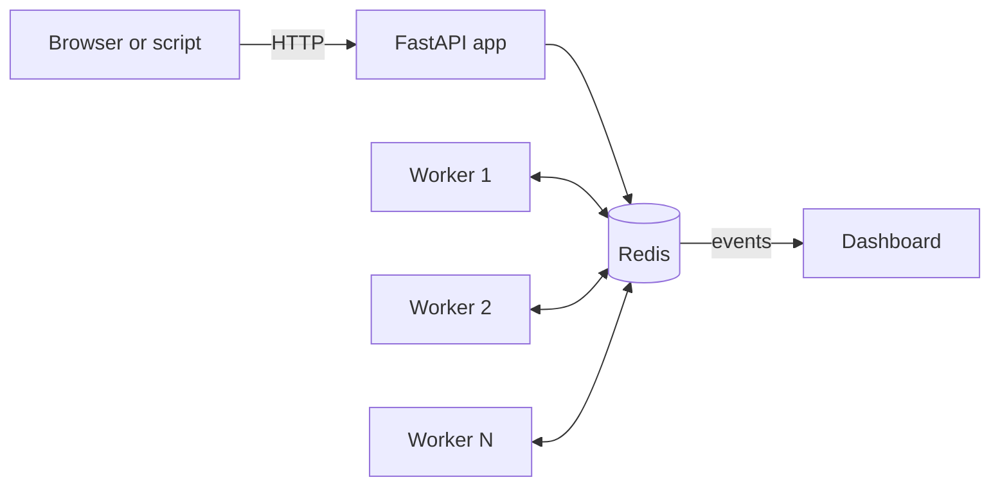
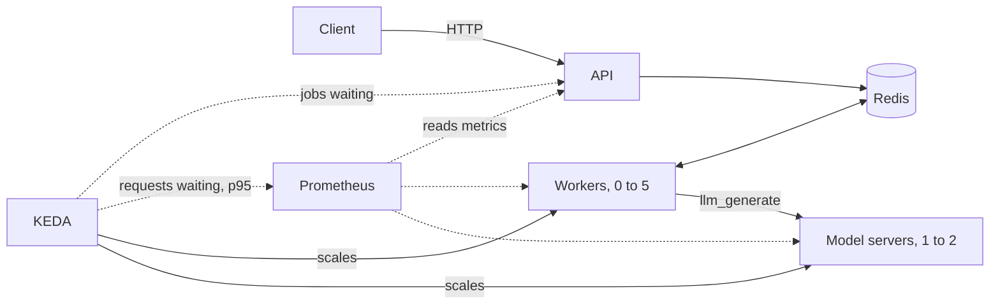
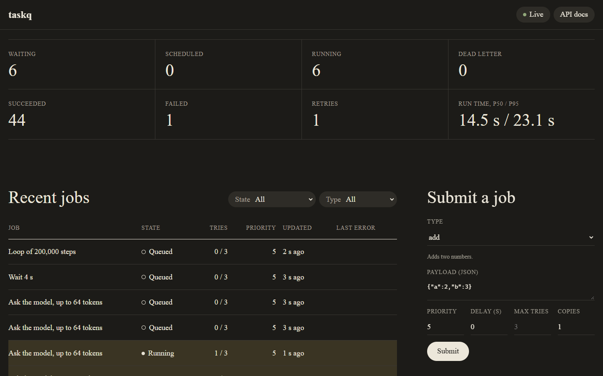

<div align="center">

# Distributed Task Processing Platform

**A job queue for background work and language model requests, with workers and model servers that scale with the load.**

[](https://github.com/khoahonguyen0210/Distributed_Task_Processing_Platform/actions/workflows/ci.yml)
[](https://github.com/khoahonguyen0210/Distributed_Task_Processing_Platform/actions/workflows/cluster.yml)


[](LICENSE)


</div>

Apps should not make people wait for slow work, such as a request to a language model. They put that work in a job queue, and background workers do it. This project builds such a queue on Redis, with a live dashboard that shows every job as it waits, runs, fails, and is tried again.

On a local Kubernetes cluster, workers send `llm_generate` jobs to llama.cpp model servers. KEDA adds and removes workers and model servers based on what Prometheus measures. The goal is that 95% of language model jobs finish within 25 s. When the queue is full, the API refuses new jobs at once instead of letting them wait too long.

## Features

- **Language model jobs.** `llm_generate` jobs go to llama.cpp model servers in the cluster. A worker tries a request again after a timeout or a server error, and stops at once when the request itself is wrong.
- **Model servers that scale on a latency goal.** KEDA reads two values from Prometheus: the requests that wait for a free model-server slot, and the p95 time from submission to result. It adds a model server when either one is above its target. The 25 s goal is twice the p95 of a measured baseline.
- **A limit on waiting jobs.** When the queue is full, the API refuses new jobs with `429 Too Many Requests`. The limit of 3 jobs on Kubernetes is worked out from the measured speed of the model servers and the 25 s goal. A job that waits past its deadline expires instead of running late.
- **Workers that start and stop with the queue.** KEDA adds workers when jobs wait and removes them when the queue is empty, down to zero. A removed worker finishes its job first.
- **Safe when a worker crashes.** A worker holds a job for a limited time, called a lease, and keeps renewing it. If the worker dies, the lease runs out and another worker takes the job.
- **Retries and dead letters.** A failed job waits longer before each new try. After 3 tries it goes to the dead-letter list, which holds jobs that keep failing. You can run them again from there.
- **Priority, delay, and cancel.** Jobs run by priority (0 to 9), can start later, and can be cancelled while they wait.
- **Metrics for every part.** The API, the workers, and the model servers all give metrics in Prometheus format. [`docs/observability.md`](docs/observability.md) lists the queries.

## Results

All numbers were measured on one Windows laptop (Intel i7-1260P). They show how the system behaves as the load changes. They do not predict results on other machines.

### Language model jobs

A small model (Qwen2.5-0.5B, 4 CPUs per model server) on a local kind cluster. One burst of 24 `llm_generate` jobs over 60 s, measured for 240 s. Median of 2 trials. **239 of 240 jobs succeeded and 1 was refused with `429`. None were lost or expired.**

| Model servers | p95 | Server-seconds |
|---|---:|---:|
| Fixed 1 | 10.1 s | 240 |
| Fixed 2 | 22.1 s | 480 |
| KEDA, 1 to 2 | 21.0 s | **345** |

- KEDA used **28% less server time** than 2 fixed servers. It added a server only when requests waited, and that server was ready about 18 s after KEDA asked for it.
- The medians were under the 25 s goal. In one trial each, fixed 2 and KEDA missed it (27.8 s and 29.2 s).
- A second server did not help on this laptop: the servers share 4 performance cores and too little memory, so the model was read from disk again and again.
- In a heavier burst (1 job per second for 60 s), KEDA asked for a second server 10 to 13 s after the burst began. It went back to 1 server 108 to 174 s after the last job finished.
- Latency varied by up to 5 times between trials of the same setup, so the job counts and server time are the reliable results. A worker or model server killed in the middle of a request lost no job.

Details and raw data: [`docs/inference.md`](docs/inference.md). How the 25 s goal was chosen: [`docs/observability.md`](docs/observability.md).

### Autoscaling workers

One burst of 120 jobs (1 s each) on the same cluster, measured for 200 s. Median of 3 trials. **1,440 of 1,440 jobs succeeded.**

| Workers | Finish time | End-to-end p95 | Worker-seconds |
|---|---:|---:|---:|
| KEDA, 0 to 5 | 32.9 s | 29.6 s | **239** |
| Fixed 1 | 120.5 s | 113.7 s | 200 |
| Fixed 3 | 40.2 s | 37.8 s | 600 |
| Fixed 5 | 24.1 s | 21.8 s | 1,000 |

- KEDA took 8.8 s longer than 5 fixed workers, but used **76% less worker time**.
- With no workers running, the first job started about 7 s after the burst.
- When KEDA removed a worker in the middle of a job, the worker finished the job first. A worker killed in the middle of a job lost nothing.

Details and raw data: [`docs/kubernetes.md`](docs/kubernetes.md).

### Queue speed

Workers run as separate processes on the laptop. 200 jobs per trial, median of 3 trials. **7,200 of 7,200 jobs succeeded.**

| Workload | 1 worker | 3 workers | 5 workers |
|---|---:|---:|---:|
| `sleep` 0.1 s (waiting, like a network call) | 9.4 jobs/s | 27.8 jobs/s | **45.6 jobs/s** |
| `cpu` 300,000 loop steps (busy CPU) | 10.7 jobs/s | 18.6 jobs/s | **31.1 jobs/s** |

- Five workers finish `sleep` jobs **4.9 times faster** than one, and `cpu` jobs about 3 times faster.
- For CPU jobs, separate processes are needed. Five threads in one process were no faster than one thread, because of Python's global interpreter lock.
- When 8 threads claimed 60 jobs at the same time, no job was given out twice.

These numbers are not the top speed of the queue. Raw data: [`benchmarks/results/20261011T034507Z/`](benchmarks/results/20261011T034507Z/).

## How it works



1. **Submit.** The API saves the job in Redis and returns at once.
2. **Claim.** A free worker takes the next job and holds it for 30 seconds. It renews that hold while it works.
3. **Finish or retry.** A job that fails waits a little, then runs again, up to 3 tries. After that, it goes to the dead-letter list, where you can run it again by hand.
4. **Recover.** If a worker crashes, its hold runs out, and another worker takes the job.

Redis stores each job as a hash, and keeps sorted sets for ready, delayed, running, and dead-letter jobs. Every step is one Lua script, which Redis runs as a single action, so two workers can never take the same job. Details are in [`docs/design.md`](docs/design.md).

A job is always in one of these states: `scheduled`, `queued`, `running`, `retry_scheduled`, `succeeded`, `failed`, `dead_letter`, `cancelled`, or `expired`.

On Kubernetes, Prometheus and KEDA are added around the same parts:



## Job types

The first five types are simple examples of real work, so each behavior is easy to see. No other type can run.

| Type | Payload (the input) | Example of |
|---|---|---|
| `add` | `{"a": 2, "b": 3}` | A quick task |
| `sleep` | `{"seconds": 2}` | Sending an email or calling another service |
| `cpu` | `{"n": 200000}` | Resizing a photo or building a report |
| `flaky` | `{"fail_times": 2}` | A service that fails a few times, then works |
| `fail` | `{"message": "text"}` | A request with bad data, which is not retried |
| `llm_generate` | `{"prompt": "Explain a queue.", "max_tokens": 64}` | Asking a language model for text (needs the model server, see [`docs/inference.md`](docs/inference.md)) |

## API

Submit a job with `POST /api/jobs`, then read it back with the `id` from the reply:

```bash
curl -X POST http://127.0.0.1:8000/api/jobs -H "Content-Type: application/json" \
  -d '{"type": "add", "payload": {"a": 2, "b": 3}}'
curl http://127.0.0.1:8000/api/jobs/<id>
```

`priority` (0 to 9, default 5), `delay_seconds`, `max_attempts`, and `deadline_seconds` are optional. A job that no worker has started by its deadline goes to `expired`. When the queue is full, the API answers `429` with a `Retry-After` header.

| Endpoint | Use |
|---|---|
| `GET /api/job-types` | The job types that can run, with the payload each one takes |
| `GET /api/jobs`, `GET /api/jobs/{id}` | List jobs (filter by `state` or `type`), read one job with its history |
| `POST /api/jobs/{id}/cancel` | Cancel a job that is still waiting |
| `GET /api/dead-letters`, `POST /api/dead-letters/{id}/replay` | List dead letters, run one again |
| `GET /api/workers` | List workers, and whether each one is still alive |
| `GET /health/live`, `GET /health/ready` | Whether the API is running, and whether Redis and the workers are too |
| `GET /metrics` | Queue size, totals, workers, and run time (`/api/metrics` returns JSON) |
| `WS /ws/events` | Each job state change as it happens, which the dashboard shows |

## Tech stack

| Area | Tools | Used for |
|---|---|---|
| API | Python, FastAPI, Pydantic | Taking jobs and reporting their state |
| Queue | Redis 7.4, Lua scripts, Pub/Sub | Storing jobs, safe claiming, live events |
| Dashboard | HTML, CSS, JavaScript, Canvas, WebSockets | Showing jobs and workers live |
| Monitoring | Health endpoints, Prometheus, PromQL | Checking the service, the latency goal, and the values KEDA scales on |
| Deployment and CI | Docker Compose, GitHub Actions, pytest, Ruff, mypy | Running the stack and checking every change |
| Autoscaling | Kubernetes (kind), KEDA, Helm | Starting and stopping workers and model servers |
| Model serving | llama.cpp, Qwen2.5-0.5B-Instruct (GGUF), httpx | Answering `llm_generate` jobs on the CPU |

## Quick start

You need Git and Docker Desktop.

```bash
git clone https://github.com/khoahonguyen0210/Distributed_Task_Processing_Platform.git
cd Distributed_Task_Processing_Platform/docker
docker compose up --build
```

Open <http://127.0.0.1:8000> and submit a job from the form. Below the live view, the dashboard shows the numbers, the recent jobs, and the workers:



The stack runs Redis, the API, and 3 workers. To try more workers, or to kill one in the middle of a job, run these in the `docker` folder:

```bash
docker compose up -d --scale worker=5
docker kill taskq-worker-1
```

The full API is at <http://127.0.0.1:8000/docs>. Stop everything with `docker compose down`.

### Without Docker for the app

You need Python 3.12 and a Redis server. Run these in the repository folder.

```powershell
py -3.12 -m venv .venv
.\.venv\Scripts\Activate.ps1
python -m pip install -e ".[dev]"
docker run -d --name taskq-redis -p 127.0.0.1:6379:6379 redis:7.4-alpine
python -m app.main
python -m app.workers --concurrency 2
```

Run the last line in its own terminal, once for each worker you want. To try `llm_generate` jobs without a model, run `python -m app.fakes.model_server` in another terminal. It answers like a model server, but with fixed text.

### On Kubernetes

You also need kind, kubectl, and Helm. Run these in the repository folder. [`docs/kubernetes.md`](docs/kubernetes.md) explains each step.

```bash
mkdir -p models
kind create cluster --config infra/kind/cluster.yaml
docker build -f docker/Dockerfile -t taskq:local .
docker save --platform linux/amd64 -o taskq.tar taskq:local
kind load image-archive taskq.tar --name taskq
helm repo add kedacore https://kedacore.github.io/charts
helm install keda kedacore/keda --version 2.21.0 --namespace keda --create-namespace --wait
kubectl apply -k infra/kubernetes/autoscaling
kubectl -n taskq port-forward svc/api 8000:8000
```

To add the language model, download the model file into `models/` and apply `infra/kubernetes/inference` instead. The steps are in [`docs/inference.md`](docs/inference.md).

## Testing

**123 tests pass**, and Ruff and mypy (strict) report 0 issues.

| Step | Command |
|---|---|
| Lint and types | `ruff check app tests scripts` and `mypy` |
| All tests (needs Redis) | `pytest -q` |
| Stack check (needs the Docker stack) | `python scripts/smoke_test.py` |
| Benchmark (needs Redis) | `python -m scripts.benchmark` |
| Kill and stop workers during jobs (needs the cluster) | `python -m scripts.chaos_test` |
| Kill model servers and workers during LLM jobs (needs the inference setup) | `python -m scripts.chaos_test model-server-kill llm-worker-kill` |
| Autoscaling benchmark (needs the cluster) | `python -m scripts.burst_benchmark` |
| LLM benchmark (needs the inference setup) | `python -m scripts.llm_benchmark` |

Tests use Redis database 15 and delete their own keys. Without Redis, only the unit tests run. The LLM tests use a fake model server, so they need no model file.

GitHub Actions runs two workflows:

- **CI** ([`ci.yml`](.github/workflows/ci.yml)), on every push and pull request: Ruff, mypy, and all tests against Redis, then the stack check against Docker Compose.
- **Cluster** ([`cluster.yml`](.github/workflows/cluster.yml)), on pushes to `main` and on pull requests: starts a kind cluster with the fake model server, runs the stack check, then kills workers in the middle of normal jobs and LLM jobs. This cluster has no KEDA, so it does not test autoscaling.

## Configuration

Settings come from environment variables or a `.env` file. Copy [`.env.example`](.env.example), which lists every setting with its default. The ones most often changed are `REDIS_URL`, `API_PORT`, `LEASE_SECONDS`, and `DEFAULT_MAX_ATTEMPTS`. For Docker Compose, `WORKERS` and `WORKER_CONCURRENCY` in `docker/.env` set the number of workers and the jobs each one runs at once. `MAX_QUEUE_DEPTH` turns on the queue limit (0 means no limit), and `LLM_SERVER_URL` points workers to the model server.

On Windows, use `127.0.0.1`, not `localhost`, in `REDIS_URL`. Otherwise each new connection waits about 2 seconds.

## Repository layout

```text
app/api/            HTTP routes
app/queue/          Redis queue and Lua scripts
app/workers/        Worker process
app/jobs/           Job types, including the language model job
app/events/         Live event stream over WebSockets
app/observability/  Health checks and metrics
app/core/           Settings, logging, and the request body limit
app/fakes/          Fake model server for tests and CI
app/dashboard/      Dashboard page
tests/              Unit tests and tests against a real Redis
scripts/            Benchmarks, stack check, and cluster tests
benchmarks/         Raw benchmark and test results
docs/               Notes on the design, Kubernetes, the model, and metrics
research/           Audit of the reference queues and the build log
docker/             Dockerfile and Docker Compose file
infra/              kind cluster and Kubernetes files
.github/workflows/  CI and Cluster workflows
```

## Privacy and security

- No personal data, accounts, tracking, or analytics. Nothing is sent outside your computer. Prompts go only to the model server in your own cluster.
- Only the six job types can run. Submitted text is never run as code. Prompts are only sent to the model, as text.
- The model file is downloaded by you and is not part of this repository. Its license is Apache-2.0.
- The API has no sign-in, so it listens only on `127.0.0.1`. Do not expose it to a network.
- In the cluster, a network policy lets only workers and Prometheus reach the model servers.
- Payloads are limited to 16 KB, and request bodies to 128 KB.

## Limits

- One Redis server holds everything.
- A job can run twice after a crash, so job code must be safe to repeat.
- High-priority jobs always go first, so a steady stream of them can keep low-priority jobs waiting.
- Measured on one laptop only. The Kubernetes cluster has one node, so all pods share the same CPU.
- The model runs on the CPU, and it is very small. On this laptop, more than 2 model servers made text generation slower, not faster.

## Future work

- Run the model servers on a GPU, for example with vLLM, and compare the cost of each token.
- Send the text to the client while the model makes it, instead of only at the end.
- Limit the jobs and tokens of each user, so one user cannot fill the queue.
- Add a Redis replica, so one crashed server does not stop the queue.
- Add sign-in to the API, so it can be used on a network.

## Author

| Name | Role | Github |
|---|---|---|
| Khoa Ho Nguyen | Author and maintainer | [@khoahonguyen0210](https://github.com/khoahonguyen0210) |

## License

MIT. See [`LICENSE`](LICENSE). No third-party code is copied into this repository.
