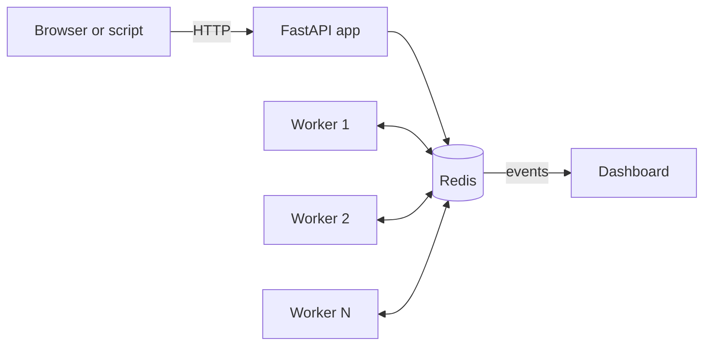

<div align="center">

# Distributed Task Processing Platform

**A platform for processing tasks in parallel.**

[](https://github.com/khoahonguyen0210/Distributed_Task_Processing_Platform/actions/workflows/ci.yml)


[](LICENSE)


</div>

Apps should not make people wait for slow work such as sending emails or building reports. They hand that work to a job queue, and background workers do it. This project builds such a queue on Redis, with a live dashboard that shows every job as it waits, runs, fails, and is tried again. On a local Kubernetes cluster, workers start when jobs arrive and stop when the queue is empty.

## Features

- **Safe when a worker crashes.** A worker holds a job for a limited time, called a lease, and keeps renewing it. If the worker dies, the lease runs out and another worker takes the job.
- **Retries and dead letters.** A failed job waits longer before each new try. After 3 tries it goes to the dead-letter list, which holds jobs that keep failing. You can run them again from there.
- **Priority, delay, and cancel.** Jobs run by priority (0 to 9), can start later, and can be cancelled while they wait.
- **Health checks and metrics.** Health endpoints, plus a `/metrics` page in Prometheus format.
- **Workers that scale themselves.** On Kubernetes, KEDA adds workers when jobs wait and removes them when the queue is empty, down to zero. A removed worker finishes its job first.

## Results

Measured on one Windows laptop (Intel i7-1260P), 200 jobs per trial, median of 3 trials. **7,200 of 7,200 jobs succeeded.**

| Workload | 1 worker | 3 workers | 5 workers |
|---|---:|---:|---:|
| `sleep` 0.1 s (waiting, like a network call) | 9.4 jobs/s | 27.8 jobs/s | **45.6 jobs/s** |
| `cpu` 300,000 loop steps (busy CPU) | 10.7 jobs/s | 18.6 jobs/s | **31.1 jobs/s** |

- Five workers finish waiting jobs **4.9 times faster** than one, and CPU jobs about 3 times faster.
- For CPU jobs, separate processes are needed. Five threads in one process were no faster than one thread, because of Python's global interpreter lock.
- A worker killed in the middle of a job lost nothing. Another worker took the job and finished it.
- When 8 threads claimed 60 jobs at the same time, no job was given out twice.
- **94 tests pass**, and Ruff and mypy (strict) report 0 issues.

These numbers show how the queue scales on one laptop. They are not its top speed, and not a production claim. Raw data: [`benchmarks/results/20261011T034507Z/`](benchmarks/results/20261011T034507Z/).

### Autoscaling on Kubernetes

One burst of 120 jobs (1 s each) on a local kind cluster, measured for 200 s. Median of 3 trials. **1,440 of 1,440 jobs succeeded.**

| Workers | Finish time | End-to-end p95 | Worker-seconds |
|---|---:|---:|---:|
| KEDA, 0 to 5 | 32.9 s | 29.6 s | **239** |
| Fixed 1 | 120.5 s | 113.7 s | 200 |
| Fixed 3 | 40.2 s | 37.8 s | 600 |
| Fixed 5 | 24.1 s | 21.8 s | 1,000 |

- KEDA finished 8.8 s after 5 fixed workers, but used **76% less worker time**.
- With no workers running, the first job started about 7 s after the burst.
- Workers stopped mid-job by a scale-down finished their jobs. A worker killed mid-job lost nothing.

Details and raw data: [`docs/kubernetes.md`](docs/kubernetes.md).

## How it works



1. **Submit.** The API saves the job in Redis and returns at once.
2. **Claim.** A free worker takes the next job and holds it for 30 seconds. It renews that hold while it works.
3. **Finish or retry.** A job that fails waits a little, then runs again, up to 3 tries. After that, it goes to the dead-letter list, where you can run it again by hand.
4. **Recover.** If a worker crashes, its hold runs out, and another worker takes the job.

Redis stores each job as a hash, and keeps sorted sets for jobs that are ready, delayed, running, or dead. Every step is one Lua script, which Redis runs as a single action, so two workers can never take the same job. Details are in [`docs/design.md`](docs/design.md).

A job is always in one of these states: `scheduled`, `queued`, `running`, `retry_scheduled`, `succeeded`, `failed`, `dead_letter`, or `cancelled`.

## Job types

These job types are simple examples of real work, so each behavior is easy to see. No other type can run.

| Type | Payload (the input) | Example of |
|---|---|---|
| `add` | `{"a": 2, "b": 3}` | A quick task |
| `sleep` | `{"seconds": 2}` | Sending an email or calling another service |
| `cpu` | `{"n": 200000}` | Resizing a photo or building a report |
| `flaky` | `{"fail_times": 2}` | A service that fails a few times, then works |
| `fail` | `{"message": "text"}` | A request with bad data, which is not retried |

## API

Submit a job with `POST /api/jobs`, then read it back with the `id` from the reply:

```bash
curl -X POST http://127.0.0.1:8000/api/jobs -H "Content-Type: application/json" \
  -d '{"type": "add", "payload": {"a": 2, "b": 3}}'
curl http://127.0.0.1:8000/api/jobs/<id>
```

`priority` (0 to 9, default 5), `delay_seconds`, and `max_attempts` are optional.

| Endpoint | Use |
|---|---|
| `GET /api/jobs`, `GET /api/jobs/{id}` | List jobs (filter by `state` or `type`), read one job with its history |
| `POST /api/jobs/{id}/cancel` | Cancel a job that is still waiting |
| `GET /api/dead-letters`, `POST /api/dead-letters/{id}/replay` | List dead letters, run one again |
| `GET /health/live`, `GET /health/ready` | Is the API up, are Redis and workers up |
| `GET /metrics` | Queue size, totals, workers, and run time (`/api/metrics` returns JSON) |

## Tech stack

| Area | Tools | Used for |
|---|---|---|
| API | Python, FastAPI, Pydantic | Taking jobs and reporting their state |
| Queue | Redis 7.4, Lua scripts, Pub/Sub | Storing jobs, safe claiming, live events |
| Dashboard | HTML, CSS, JavaScript, Canvas, WebSockets | Showing jobs and workers live |
| Monitoring | Health endpoints, Prometheus text format | Checking the service and reading metrics |
| Deployment and CI | Docker Compose, GitHub Actions, pytest, Ruff, mypy | Running the stack and checking every change |
| Autoscaling | Kubernetes (kind), KEDA, Helm | Starting and stopping workers by queue size |

## Quick start

You need Git and Docker Desktop.

```bash
git clone https://github.com/khoahonguyen0210/Distributed_Task_Processing_Platform.git
cd Distributed_Task_Processing_Platform/docker
docker compose up --build
```

Open <http://127.0.0.1:8000> and submit a job from the form. The stack runs Redis, the API, and 3 workers. To try more workers, or to kill one in the middle of a job, run these in the `docker` folder:

```bash
docker compose up -d --scale worker=5
docker kill taskq-worker-1
```

The full API is at <http://127.0.0.1:8000/docs>. Stop everything with `docker compose down`.

### Without Docker for the app

You need Python 3.12 and a Redis server. Run these in the repository folder.

```powershell
py -3.12 -m venv .venv
.\.venv\Scripts\Activate.ps1
python -m pip install -e ".[dev]"
docker run -d --name taskq-redis -p 127.0.0.1:6379:6379 redis:7.4-alpine
python -m app.main
python -m app.workers --concurrency 2
```

Run the last line in its own terminal, once for each worker you want.

### On Kubernetes

You also need kind, kubectl, and Helm. Run these in the repository folder. [`docs/kubernetes.md`](docs/kubernetes.md) explains each step.

```bash
kind create cluster --config infra/kind/cluster.yaml
docker build -f docker/Dockerfile -t taskq:local .
docker save --platform linux/amd64 -o taskq.tar taskq:local
kind load image-archive taskq.tar --name taskq
helm repo add kedacore https://kedacore.github.io/charts
helm install keda kedacore/keda --version 2.21.0 --namespace keda --create-namespace --wait
kubectl apply -k infra/kubernetes/autoscaling
kubectl -n taskq port-forward svc/api 8000:8000
```

## Testing

| Step | Command |
|---|---|
| Lint and types | `ruff check app tests scripts` and `mypy` |
| All tests (needs Redis) | `pytest -q` |
| Stack check (needs the Docker stack) | `python scripts/smoke_test.py` |
| Benchmark (needs Redis) | `python -m scripts.benchmark` |
| Kill and stop workers during jobs (needs the cluster) | `python -m scripts.chaos_test` |
| Autoscaling benchmark (needs the cluster) | `python -m scripts.burst_benchmark` |

Tests use Redis database 15 and delete their own keys. Without Redis, only the unit tests run.

## Configuration

Settings come from environment variables or a `.env` file. Copy [`.env.example`](.env.example), which lists every setting with its default. The ones most often changed are `REDIS_URL`, `API_PORT`, `LEASE_SECONDS`, and `DEFAULT_MAX_ATTEMPTS`. For Docker Compose, `WORKERS` and `WORKER_CONCURRENCY` in `docker/.env` set the number of workers and the jobs each one runs at once.

On Windows, use `127.0.0.1`, not `localhost`, in `REDIS_URL`. Otherwise each new connection waits about 2 seconds.

## Repository layout

```text
app/api/        HTTP routes
app/queue/      Redis queue and Lua scripts
app/workers/    Worker process
app/jobs/       Job types
app/dashboard/  Dashboard page
tests/          Unit tests and tests against a real Redis
scripts/        Benchmarks, stack check, and cluster tests
benchmarks/     Raw benchmark and test results
docs/           Design notes and images
docker/         Dockerfile and Docker Compose file
infra/          kind cluster and Kubernetes files
```

## Privacy and security

- No personal data, accounts, tracking, or analytics. Nothing is sent outside your computer.
- Only the five job types can run. Submitted text is never run as code.
- The API has no sign-in, so it listens only on `127.0.0.1`. Do not expose it to a network.
- Payloads are limited to 16 KB, and request bodies to 128 KB.

## Limits

- One Redis server holds everything.
- A job can run twice after a crash, so job code must be safe to repeat.
- High-priority jobs always go first, so a steady stream of them can keep low-priority jobs waiting.
- Measured on one laptop only. The Kubernetes cluster has one node, so all pods share the same CPU.

## Future work

- Add a Redis replica, so one crashed server does not stop the queue.
- Add sign-in to the API, so it can be used on a network.
- Let users register their own job types.

## Author

| Name | Role | Github |
|---|---|---|
| Khoa Ho Nguyen | Author and maintainer | [@khoahonguyen0210](https://github.com/khoahonguyen0210) |

## License

MIT. See [`LICENSE`](LICENSE). No third-party code is copied into this repository.
