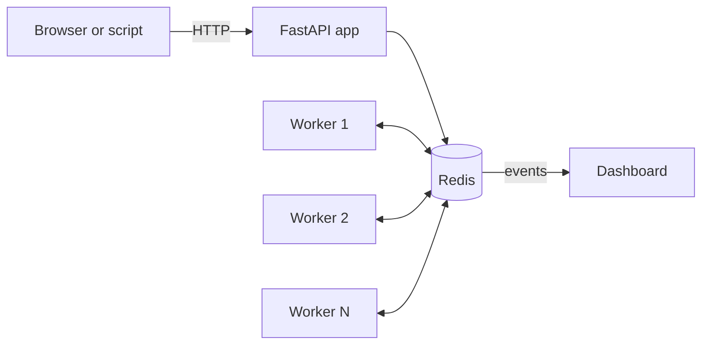

<div align="center">

# Distributed Task Processing Platform

**A platform for processing tasks in parallel.**

[](https://github.com/khoahonguyen0210/Distributed_Task_Processing_Platform/actions/workflows/ci.yml)


[](LICENSE)


</div>

Apps should not make people wait for slow work such as sending emails or building reports. They hand that work to a job queue, and background workers do it. This project builds such a queue on Redis, with a live dashboard that shows every job as it waits, runs, fails, and is tried again.

## Results

Measured on one Windows laptop (Intel i7-1260P), 200 jobs per trial, median of 3 trials. **7,200 of 7,200 jobs succeeded.**

| Workload | 1 worker | 3 workers | 5 workers |
|---|---:|---:|---:|
| `sleep` 0.1 s (waiting, like a network call) | 9.4 jobs/s | 27.8 jobs/s | **45.6 jobs/s** |
| `cpu` 300,000 loop steps (busy CPU) | 10.7 jobs/s | 18.6 jobs/s | **31.1 jobs/s** |

- Five workers finish waiting jobs **4.9 times faster** than one, and CPU jobs about 3 times faster.
- For CPU jobs, separate processes are needed. Five threads in one process were no faster than one thread, because of Python's global interpreter lock.
- A worker killed in the middle of a job lost nothing. Another worker took the job and finished it.
- When 8 threads claimed 60 jobs at the same time, no job was given out twice.
- **90 tests pass**, and Ruff and mypy (strict) report 0 issues.

Raw data: [`benchmarks/results/20261011T034507Z/`](benchmarks/results/20261011T034507Z/).

## How it works



1. **Submit.** The API saves the job in Redis and returns at once.
2. **Claim.** A free worker takes the next job and holds it for 30 seconds. It renews that hold while it works.
3. **Finish or retry.** A job that fails waits a little, then runs again, up to 3 tries. After that, it goes to a dead-letter list, where it can be run again by hand.
4. **Recover.** If a worker crashes, its hold runs out, and another worker takes the job.

Every step is one Lua script, so Redis runs it as a single action and two workers can never take the same job. Jobs can also have a priority (0 to 9) or a delay. Details are in [`docs/design.md`](docs/design.md).

## Job types

The job types are stand-ins for real work, so each behavior is easy to see. No other type can run.

| Type | Payload | Stands in for |
|---|---|---|
| `add` | `{"a": 2, "b": 3}` | A quick task |
| `sleep` | `{"seconds": 2}` | Sending an email or calling another service |
| `cpu` | `{"n": 200000}` | Resizing a photo or building a report |
| `flaky` | `{"fail_times": 2}` | A service that fails a few times, then works |
| `fail` | `{"message": "text"}` | A request with bad data, which is not retried |

## Tech stack

| Area | Tools |
|---|---|
| API | Python, FastAPI, Pydantic |
| Queue | Redis 7.4 with Lua scripts and Pub/Sub |
| Dashboard | HTML, CSS, JavaScript, Canvas, WebSockets |
| Deployment and CI | Docker Compose, GitHub Actions, pytest, Ruff, mypy |

## Quick start

You need Docker Desktop.

```bash
cd docker
docker compose up --build
```

Open <http://127.0.0.1:8000> and submit a job from the form. The stack runs Redis, the API, and 3 workers. To try more workers, or to kill one in the middle of a job, run these in the `docker` folder:

```bash
docker compose up -d --scale worker=5
docker kill taskq-worker-1
```

The full API is at <http://127.0.0.1:8000/docs>. Stop everything with `docker compose down`.

### Without Docker for the app

You need Python 3.12 and a Redis server.

```powershell
py -3.12 -m venv .venv
.\.venv\Scripts\Activate.ps1
python -m pip install -e ".[dev]"
docker run -d --name taskq-redis -p 127.0.0.1:6379:6379 redis:7.4-alpine
python -m app.main
python -m app.workers --concurrency 2
```

Run the last line in its own terminal, once for each worker you want.

## Testing

| Step | Command |
|---|---|
| Lint and types | `ruff check app tests scripts` and `mypy` |
| All tests (needs Redis) | `pytest -q` |
| Stack check (needs the Docker stack) | `python scripts/smoke_test.py` |
| Benchmark (needs Redis) | `python -m scripts.benchmark` |

Tests use Redis database 15 and delete their own keys. Without Redis, only the unit tests run.

## Configuration

Settings come from environment variables or a `.env` file. Copy [`.env.example`](.env.example), which lists every setting with its default. The ones most often changed are `REDIS_URL`, `API_PORT`, `LEASE_SECONDS`, and `DEFAULT_MAX_ATTEMPTS`.

On Windows, use `127.0.0.1`, not `localhost`, in `REDIS_URL`. Otherwise each new connection waits about 2 seconds.

## Repository layout

```text
app/api/        HTTP routes
app/queue/      Redis queue and Lua scripts
app/workers/    Worker process
app/jobs/       Job types
app/dashboard/  Dashboard page
tests/          Unit tests and tests against a real Redis
scripts/        Benchmark and stack check
docs/           Design notes and images
docker/         Dockerfile and Docker Compose file
```

## Privacy and security

- No personal data, accounts, tracking, or analytics. Nothing is sent outside your computer.
- Only the five job types can run. Submitted text is never run as code.
- The API has no sign-in, so it listens only on `127.0.0.1`. Do not expose it to a network.
- Payloads are limited to 16 KB.

## Limits

- One Redis server holds everything.
- A job can run twice after a crash, so job code must be safe to repeat.
- High-priority jobs always go first, so a steady stream of them can keep low-priority jobs waiting.
- Measured on one laptop only.

## Author

| Name | Role | Github |
|---|---|---|
| Khoa Ho Nguyen | Author and maintainer | [@khoahonguyen0210](https://github.com/khoahonguyen0210) |

## License

MIT. See [`LICENSE`](LICENSE). No third-party code is copied into this repository.
